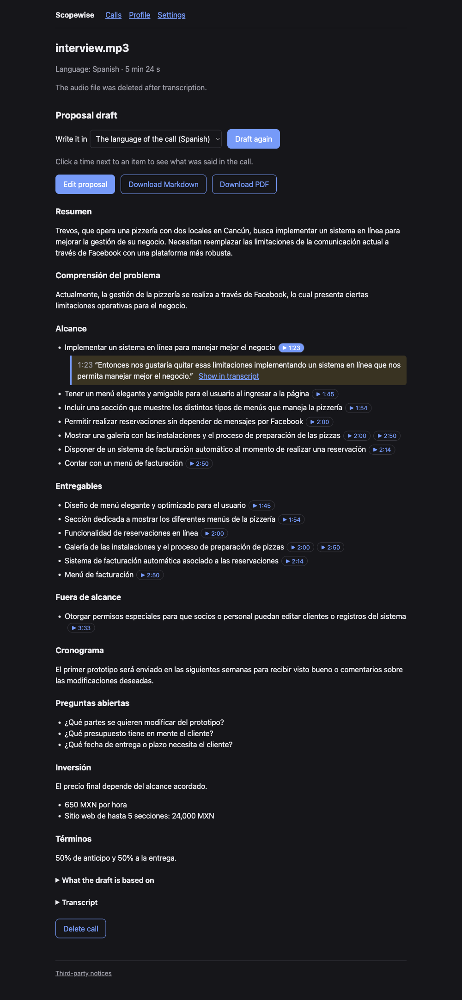
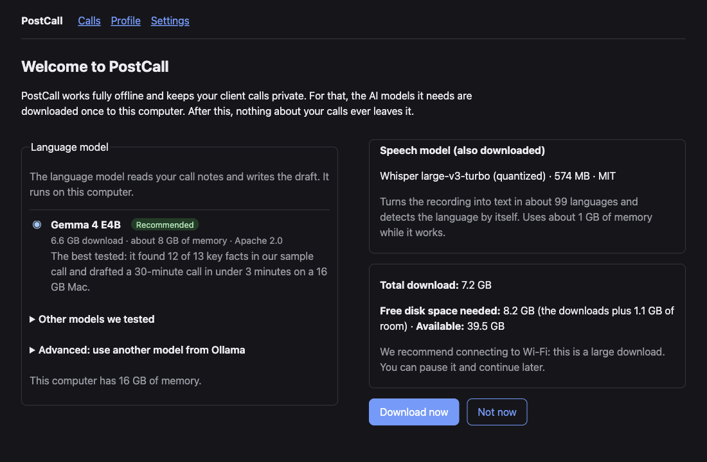
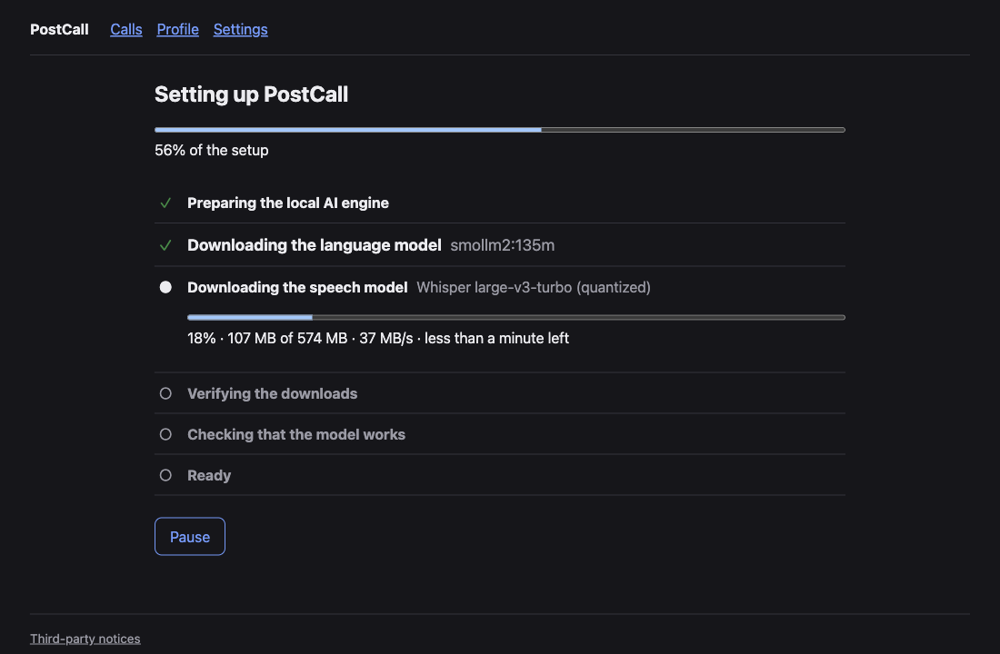
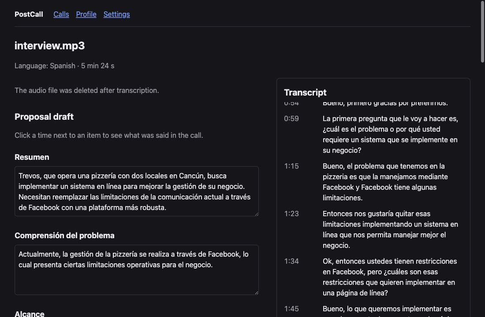
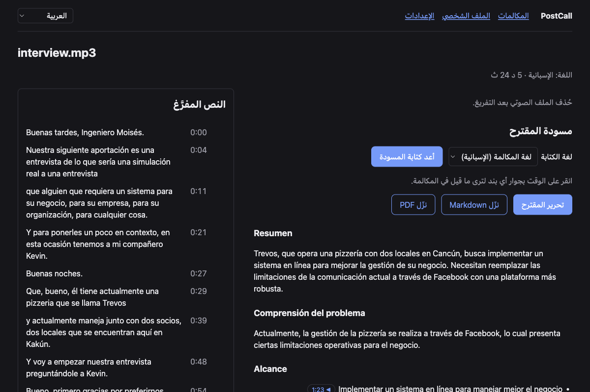
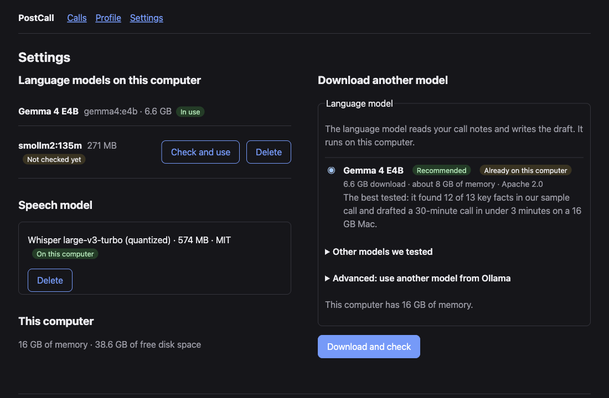
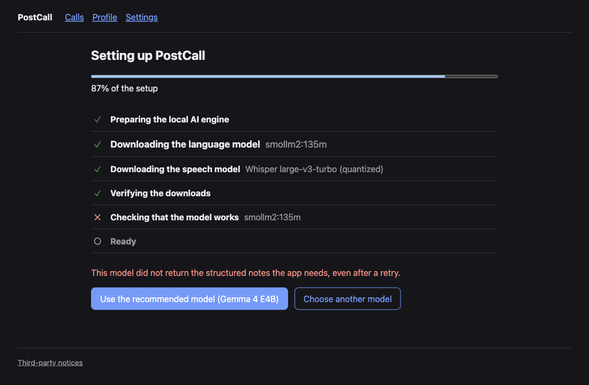
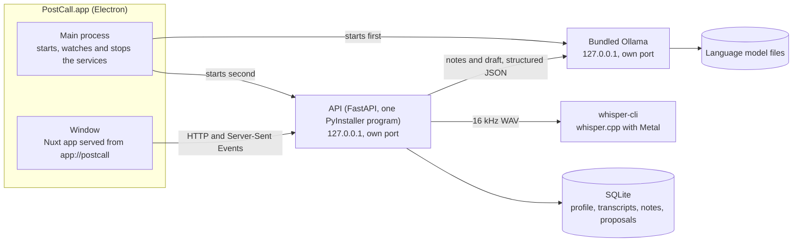

# PostCall

**Turn a recorded client discovery call into a draft proposal in minutes. On your own Mac, with open-source AI, without sending the call to anyone's server.**

PostCall is a desktop app for freelancers and small agencies, for macOS, Windows and Linux. You upload the recording of a call, and it transcribes it, pulls out what the client actually said, and drafts a proposal from those notes and your own rates. Everything runs on your computer: the speech model, the language model and the data. After a one-time model download it works fully offline.

Built for the DEV Open-Source AI Challenge, Week 2: "Side Hustle". Source code: MIT with a Beerware thank-you (see [License](#license)).



## The problem

Writing the proposal is unpaid work that happens after every discovery call. It takes hours, and it is the first thing that slips when you are busy. The obvious fix, pasting the call into a cloud AI, is often not allowed: discovery calls contain the client's plans, numbers and sometimes an NDA.

## Who it is for

Freelancers (developers, designers, consultants, writers) and small agencies, anywhere in the world, who run discovery calls and then write scope-and-price proposals. The proposal is written in the language of the call, or in any of the eleven languages below, which are also the languages of the interface.

## How it works

1. **First launch.** The app explains that it works offline and asks to download its AI models once. You see the sizes, the memory each needs, the free disk space and a Wi-Fi recommendation, then choose "Download now" or "Not now" (nothing else works without the models; the question returns next launch).
2. **Profile (once).** Your name or business, services, rates in any currency, payment terms, preferred sections and tone.
3. **New proposal.** Upload an mp3, m4a, wav or mp4. A reminder says every participant must have agreed to being recorded.
4. **Transcript.** whisper.cpp transcribes with timestamps and detects the language. The audio file is deleted afterwards unless you choose to keep it.
5. **Notes.** The language model extracts the client, the problem in the client's own words, goals, requirements, constraints, mentioned budget or deadlines, risks and open questions. Long calls are processed in 8-minute chunks and merged.
6. **Draft.** The model writes the proposal from the notes. Your rates and terms are inserted by code, never invented by the model.
7. **Edit and export.** Fix anything in the app, then export Markdown or PDF.





### What keeps the draft honest

- **Every scope item and deliverable links to the moment it came from.** Click the time next to an item to read the exact quote and jump to it in the transcript. The quote is looked up by the app from the transcript, never written by the model.
- **Anything without a source is flagged as an assumption**, and an item you add yourself can never be un-flagged.
- **Prices come only from your profile.** A budget the client mentioned is shown as a labelled note, never used as a price. The summary never contains a price, and pricing always comes after the scope.
- **If the call did not cover something, the draft says so** and adds it to the open questions (for example, when nobody mentioned a budget or a deadline).
- **You stay in charge.** The model still makes mistakes. In the included sample the client asks for an automatic invoicing system, and the interviewer's recap says "un menú de facturación", so the draft lists both. The source links make that easy to spot and the editor lets you remove it. Read the draft before you send it.



## Install

| System | Installer | Needs |
| --- | --- | --- |
| **macOS** | `PostCall-<version>-arm64.dmg` | Apple Silicon (M1 or newer), macOS 14 or later. Intel Macs are not supported. |
| **Windows** | `PostCall-<version>-x64-setup.exe` | Windows 11 on a 64-bit PC (Windows 10 22H2 should work, untested), a CPU with AVX2 (Intel since 2013, AMD since 2015). |
| **Linux** | `postcall_<version>_amd64.deb` or `PostCall-<version>-x86_64.AppImage` | A 64-bit distribution with glibc 2.35 or newer (Ubuntu 22.04, Linux Mint 21, Debian 12, Fedora 36 or newer), a CPU with AVX2. The AppImage also needs FUSE 2. |

Download the file for your system from the [Releases page](https://github.com/RZEROSTERN/hacktoberfest-week3/releases) and check it against `SHA256SUMS` there. **The installers are not signed** (certificates cost money and this is a free project), so each system warns the first time; the steps are below. Release 1.0.0 contains the macOS installer only; the Windows and Linux installers are built by CI (see [Releases](#releases)) and are attached starting with the next release. They have been built and smoke-tested on CI runners of each system, but not yet tried on real hardware (see [Known limits](#known-limits)).

### macOS

1. Download `PostCall-1.0.0-arm64.dmg` (306 MB).
2. Open it and drag **PostCall** into **Applications**.
3. **Open the app for the first time.** The app is not signed with an Apple Developer certificate (that costs money and this is a free project), so macOS blocks it the first time. Following [Apple's own instructions](https://support.apple.com/en-us/102445):
   1. Try to open PostCall, so macOS shows its warning, then close the warning.
   2. Open **System Settings → Privacy & Security** and scroll down.
   3. Click **Open Anyway** next to the message about PostCall, and confirm.
   4. The warning appears once more; click **Open**. PostCall opens normally from then on.

   If you prefer the Terminal, `xattr -dr com.apple.quarantine /Applications/PostCall.app` removes the "downloaded from the internet" flag so the warning never appears. This is a widely used workaround, not part of Apple's instructions.
### Windows

1. Run `PostCall-<version>-x64-setup.exe` (about 170 MB). Windows shows **"Windows protected your PC"** because the installer is not signed: click **More info**, then **Run anyway**.
2. Choose the folder (it installs for your user and does not need administrator rights) and finish. Open PostCall from the Start menu.

### Linux

- **`.deb`** (Linux Mint, Ubuntu, Debian; about 170 MB): `sudo apt install ./postcall_<version>_amd64.deb`, then open PostCall from the menu or run `postcall`.
- **AppImage** (about 210 MB): make it executable with `chmod +x PostCall-<version>-x86_64.AppImage` (or in the file manager: Properties, *Allow executing*) and run it. If it complains about `libfuse.so.2`, install FUSE 2 (`sudo apt install libfuse2`, or `libfuse2t64` on Ubuntu 24.04 and Mint 22). If it stops with a sandbox error, use the `.deb`.

### First launch: the model download (all systems)

4. The request screen shows what will be downloaded:

   | | Size |
   | --- | --- |
   | Language model, Gemma 4 E4B (recommended) | 6.6 GB |
   | Speech model, Whisper large-v3-turbo (quantized) | 574 MB |
   | **Total download** | **7.2 GB** |
   | Free disk space needed | 8.2 GB (the downloads plus 1 GB of room) |

   Use Wi-Fi. The app then prepares its local AI engine, downloads both models, verifies them (the speech model against a fixed checksum), and runs a short built-in sample through the language model to confirm it can produce the structured notes the app needs. Downloads can be paused and resumed, survive closing the app, and offer a retry if the network drops. This is the only time the app uses the internet.

PostCall keeps its data, models and logs in one folder: `~/Library/Application Support/PostCall` on macOS, `%APPDATA%\PostCall` on Windows and `~/.config/PostCall` on Linux. The uninstallers leave it alone on purpose (it holds the models, about 7.2 GB); to remove everything, uninstall the app and delete that folder.

## Languages

PostCall's interface is available in **English, Spanish, French, Portuguese, Japanese, German, Russian, Italian, Hindi, Chinese (Simplified) and Arabic**. It opens in your computer's language when it is one of these (English otherwise); change it any time with the language list at the top right, and PostCall remembers your choice. Arabic runs right to left, and the proposal and transcript text keep their own direction, so a Spanish proposal reads correctly inside an Arabic window.



- **Proposals** can be written in any of the eleven languages, whatever the interface language is. The section titles and fixed sentences (price note, "to be confirmed", the budget and deadline questions) exist in all eleven; the rest is written by the language model, so quality depends on the model you chose.
- **Sizes, speeds and times** use each language's own number and unit conventions.
- **Stays in English:** the third-party license texts (they are legal text published by their authors), the names of models and engines, and the few messages the app does not have a translation for yet.
- **Translations are drafts.** They were written with AI assistance, with the section names matched to the wording the generated proposals use, and checked by tests (every language has every message, with the same values) and by looking at the screens in all eleven languages. No native speaker has reviewed them, so expect some stiff or imperfect wording. To fix one, edit its file in [`web/app/locales/`](web/app/locales/), run the web tests (`cd web && npm test`), and open a pull request; English (`en.json`) is the source for everything.
- **Before the window opens**, the start page and the error dialogs use the system language.

## Choosing and switching models

The first-launch screen preselects the best-tested model, **Gemma 4 E4B**. Open **Other models we tested** to see the alternatives with their size, memory needs, license and a note on speed and quality; models that need more memory than your Mac has are shown as "Not recommended for this computer". **Advanced: use another model from Ollama** accepts any name and tag from the [Ollama library](https://ollama.com/library); untested models may give lower quality, and cloud models are refused because your calls must stay on this computer.

Every model, including the one you type, goes through the same compatibility check before it can be used: if it cannot return valid structured notes, the app explains why and offers the recommended model.

Later, in **Settings**, you can switch to another downloaded model ("Check and use"), download a new one with the same flow, or delete models to free disk space.





## Hardware

**Windows and Linux** run the speech model and the language model on the **CPU**, or on a graphics card through Vulkan when its driver supports it (AMD, Intel and NVIDIA); NVIDIA's CUDA libraries are not included, to keep the installers small. Nothing has been timed on these systems yet: the speed targets below were measured on a Mac with Metal, and a CPU-only computer will be slower, perhaps much slower on an older laptop. [The release checklist](docs/RELEASE_CHECKLIST.md) records the first Windows and Linux numbers.

The numbers come from [docs/BENCHMARKS.md](docs/BENCHMARKS.md), measured on a MacBook with an M2 Pro and 16 GB of memory, on a busy desktop (browser, IDE, Docker).

| | Minimum | Recommended |
| --- | --- | --- |
| Chip and system | Apple Silicon, macOS 14 | Apple Silicon (M2 or newer), macOS 14 or later |
| Memory | 8 GB (an estimate, see below) | 16 GB |
| Free disk | 8.2 GB for the first launch, plus 0.8 GB for the app | More if you want to try other models (3 to 8 GB each) |

What was measured with the default models:

| | 5 min 24 s call | 32 min call |
| --- | --- | --- |
| Transcription (whisper.cpp, Metal) | 17.7 s | 88 s |
| Notes plus proposal (Gemma 4 E4B) | 64 s | 160 s |

Memory while working: about 1 GB for transcription and 4.6 GB for Gemma 4 E4B. The 8 GB minimum is the figure the app shows for the default model; it was **not** tested on an 8 GB Mac. The 32-minute file is the 5-minute call repeated six times, so it measures speed, not quality. Inside the packaged app, on a quiet Mac, the 5-minute call took 29 s to transcribe and 52 s for notes and proposal. On a busy Mac (browser, IDE, Docker, a model already loaded) the same call took 74 s and 140 s, so expect a range.

## The models we tested

All five were run on the same sample call with the same prompts ([details and caveats](docs/BENCHMARKS.md)). Targets: a 30-minute call transcribed in under 10 minutes, notes plus proposal in under 3 minutes, at least 90% of the expected key facts, no invented requirements or prices.

| Model | License | Download | Memory | 5-min call | 32-min call | Key facts | Verdict |
| --- | --- | --- | --- | --- | --- | --- | --- |
| **`gemma4:e4b`** | Apache 2.0 | 6.6 GB | 4.6 GB | **64 s** | **160 s** | **12 / 13 (92%)** | Meets the targets on the 5-minute call (one wrong out-of-scope item in the 32-minute run). The default. |
| `qwen3.5:9b` | Apache 2.0 | 6.6 GB | 6.3 GB | 126 s | 322 s | 12 / 13 (92%) | Too slow at 30 minutes; added two small details nobody said. |
| `qwen3.5:4b` | Apache 2.0 | 3.3 GB | 3.8 GB | 42 s | 175 s | 9 / 13 (69%) | Fast, but missed facts and invented an out-of-scope item. |
| `mistral-nemo:12b` | Apache 2.0 | 7.1 GB | 7.6 GB | 82 s | not run | 8 / 13 (62%) | Thin notes. |
| `gemma4:12b` | Apache 2.0 | 8.0 GB | about 9 GB | 239 s | not run | 4.5 / 13 (35%) | Too slow and too terse on a 16 GB Mac. |

Transcription: whisper.cpp with `large-v3-turbo` (q5_0, MIT) beat faster-whisper on speed (about six times faster on Apple Silicon, where faster-whisper runs on the CPU), on size to bundle (8 MB against about 330 MB) and on simplicity, so it is the engine.

**Honest limits of these numbers:** one 5-minute Spanish role-play, one run per configuration, and 13 key facts (one fact is 7.7 percentage points). The key facts file is a draft written from a transcript and still waiting for a person who heard the call to confirm it; the scores were assigned by Claude, not by a person. There is no human-checked transcript, so real word accuracy is unknown.

## Architecture



| Part | What it is |
| --- | --- |
| `api/` | FastAPI (Python 3.12, uv, SQLModel/SQLite). Transcription and drafting run as background jobs with progress. Prompts live in versioned files in `api/prompts/`. Every model output is validated with Pydantic, retried once, then reported as a clear error. Configured only through `POSTCALL_*` environment variables. |
| `web/` | Nuxt 4 in SPA mode (TypeScript strict), generated as static files. Composables call the API; components only present. |
| `desktop/` | Electron shell (TypeScript). Picks two free loopback ports, starts the bundled Ollama and then the API, waits for both health checks, serves the web app from its own `app://` address with a strict content security policy, restarts a crashed service once, and stops everything on quit. Sandboxed window, one value exposed to the page. |
| `samples/` | Role-played, consented sample calls and their expected key facts. |
| `spike/` | The model benchmark scripts (not shipped). |
| `docs/` | [DECISIONS.md](docs/DECISIONS.md) (every technical decision and why), [BENCHMARKS.md](docs/BENCHMARKS.md), [RELEASE_CHECKLIST.md](docs/RELEASE_CHECKLIST.md) (the manual test before each release), and [DEPLOYMENT.md](docs/DEPLOYMENT.md) (the plan for the Mac App Store and what is left for Windows and Linux). |

The packaged app contains the Ollama standalone build (v0.35.1; on Windows and Linux its CPU and Vulkan backends, without the CUDA libraries), the API as one program, a static `whisper-cli` built from a pinned whisper.cpp revision, on Windows and Linux a small LGPL-only FFmpeg for reading audio (macOS has its own converter), and the generated web app. The macOS `.dmg` is 308 MB (about 800 MB installed); the Windows installer is 170 MB, the Linux `.deb` 170 MB and the AppImage 210 MB.

## Privacy

- Everything runs on your computer. The API and the bundled Ollama listen on `127.0.0.1` only. The app always uses its own Ollama, never one installed on your system.
- The only network traffic is the model download you approve: the language model from the Ollama library, and the speech model from Hugging Face.
- Audio is deleted after transcription unless you keep it. Transcripts, notes and proposals are stored in a local SQLite database.
- No analytics, no telemetry, and the app never logs transcript or proposal content.

## Run it in development

You need a Mac with Apple Silicon, [uv](https://docs.astral.sh/uv/), Node 24 (what the project is developed with), the Xcode command-line tools (to build whisper.cpp), and [Ollama](https://ollama.com) running natively. Run Ollama on the Mac itself, not in Docker, so it can use the Apple GPU.

```sh
git clone https://github.com/RZEROSTERN/hacktoberfest-week3.git
cd hacktoberfest-week3
make setup         # api and web dependencies, creates .env
make whisper-dev   # builds whisper.cpp (the API needs its whisper-cli)
make dev           # api on 127.0.0.1:8765 and web on http://localhost:3000
```

The first visit shows the same model request as the packaged app, using your Ollama. Other commands:

```sh
make test lint typecheck     # api, web and desktop
make test-llm                # opt-in: runs the real language model on the sample call (about 4.6 GB)
make desktop-setup           # once: desktop dependencies (Electron is downloaded into .dev/)
make desktop-dev             # run the Electron shell from the repository (after make desktop-resources)
make desktop-dist            # build everything and the macOS arm64 .dmg into desktop/release/
make desktop-check           # start the shell for real and check processes, ports, isolation and quitting
```

`make help` lists everything. `web/ui-check/README.md` explains how the real screens are checked with a headless browser.

### Build the installer on your own computer

`npm run dist` builds the installer for the system you run it on, with the same steps as CI (a test fails if they differ). It needs Node 22 or newer ([nodejs.org](https://nodejs.org)) and checks the rest first, telling you how to install anything missing. No `make` is needed.

| System | Install once |
| --- | --- |
| macOS | [uv](https://docs.astral.sh/uv/), the Xcode command-line tools (`xcode-select --install`), `brew install cmake` |
| Windows | [uv](https://docs.astral.sh/uv/), [CMake](https://cmake.org/download/), Visual Studio Build Tools 2022 with "Desktop development with C++", and [MSYS2](https://www.msys2.org/) with `pacman -S --needed make diffutils xz curl mingw-w64-ucrt-x86_64-gcc mingw-w64-ucrt-x86_64-nasm` run in its UCRT64 shell (if MSYS2 is not in `C:\msys64`, set `MSYS2_ROOT`) |
| Linux | [uv](https://docs.astral.sh/uv/), `sudo apt install build-essential cmake nasm zstd binutils` |

```sh
npm run dist                          # everything; the installer ends up in desktop/release/
npm run dist -- --from build-api      # continue at a step after fixing what stopped it
npm run dist -- --list                # the steps (also --only <step>, --skip-smoke, --dry-run)
```

On Windows and Linux it downloads Ollama's 1.4 GB archive and keeps only the CPU and Vulkan parts; a whole build takes 3 to 9 minutes on a hosted CI runner. The macOS-only `make` targets (`make desktop-dist`, `make desktop-resources`) call the same scripts.

## Releases

Installers are built by GitHub Actions, never by hand, unless CI is down.

1. Create `release/<version>` from `develop`, set the version in `desktop/package.json` and `api/pyproject.toml`, and open a pull request into `master`. The `Build installers` workflow runs on it and attaches the three installers (macOS, Windows, Linux) to the run as artifacts: an early signal that everything builds.
2. Merge it, then tag the merge commit on `master`: `git tag -a v<version> <commit> -m "<version>"` and `git push origin v<version>`.
3. The `Release (draft)` workflow checks that the tag matches the app versions and is on `master`, rebuilds the three installers, writes `SHA256SUMS` and release notes, and creates a **draft** GitHub Release with everything attached. **It never publishes.**
4. Follow [docs/RELEASE_CHECKLIST.md](docs/RELEASE_CHECKLIST.md) on the three test machines with the files of the draft. Edit the notes, then publish the draft by hand.
5. Merge `master` back into `develop` through a pull request.

**If CI is down:** run `npm run dist` on each machine and copy the four installers into one folder. Then `node scripts/release.mjs prepare <folder> <version>` writes `SHA256SUMS` and `RELEASE_NOTES.md` there, and `gh release create v<version> --draft --verify-tag --notes-file <folder>/RELEASE_NOTES.md <folder>/PostCall-* <folder>/postcall_* <folder>/SHA256SUMS` creates the draft (do not attach the per-file `.sha256` files). Publish it by hand after the checklist, as always.

More about the CI: the workflows are in `.github/workflows/`; a pull request into `develop` can ask for a build with the label `ci-build`, a release rehearsal with `ci-release-rehearsal`, and a check of `npm run dist` with `ci-dist-check`.

## Branching model

GitFlow, with one rule that keeps the history simple: **no stacked pull requests**.

```
feature/<name> --PR--> develop --PR from release/<version>--> master   (then tag vX.Y.Z)
                          ^                                       |
                          '------------ master merged back -------'
hotfix/<name> (from master) --PR--> master, then merged back into develop
```

- `master` is production. It only changes through `release/*` or `hotfix/*` pull requests.
- `develop` is the integration branch. It only changes through `feature/*` pull requests.
- One `feature/<name>` branch per piece of work, always created from the latest `develop`, with small [Conventional Commits](https://www.conventionalcommits.org/).
- Every pull request targets `develop` (or `master` for a release or hotfix) and is merged with a merge commit. A branch is never created from another feature branch.
- Lint, typecheck and tests must pass before each commit.

## Third-party licenses

PostCall is made of open-source parts: Ollama (MIT) with llama.cpp and MLX (MIT), whisper.cpp (MIT), FFmpeg on Windows and Linux (LGPL-2.1-or-later, built without any GPL part and run as a separate program), the Whisper model (MIT), the Gemma 4 language model (Apache 2.0) and the other models we tested (Apache 2.0), Electron and Chromium, Python and its libraries, and Nuxt and Vue (MIT). The full list, with versions and where each license text ships in the app, is in [THIRD_PARTY_NOTICES.md](THIRD_PARTY_NOTICES.md). The same text is inside the app, under **Third-party notices** at the bottom of every screen.

## Pricing idea

A **one-time license, no subscription.** Most AI products charge monthly because every use costs them money in cloud inference. Here inference runs on the customer's own Mac and costs nothing to run, so there is no running cost to pass on and nothing that has to be rented back every month. This is an idea for how the app could be sold; nothing is charged today.

## Why open source matters here

- **Confidential calls never leave the machine.** The whole path from recording to proposal is open code and open models running locally, so "your NDA call stays private" is something anyone can verify in the source, not a promise in a privacy policy.
- **Zero cost per proposal.** There is no API bill that grows with usage, so a freelancer can draft every proposal, including the ones that do not win.
- **It works offline.** After the download, no internet connection is needed.
- **You pick the model.** The model in use is a setting, not a hardcoded dependency: the recommended Gemma 4 E4B, any model we tested, or any model in the Ollama library. When a better open model appears, you switch in Settings.
- **A fully open stack can be shipped inside the app.** Ollama, whisper.cpp and the models can all be redistributed under permissive licenses, which is what makes a one-install app with no accounts and no servers possible.

## Known limits

- macOS: Apple Silicon and macOS 14 or later only; the first release has been tried on macOS 27 only.
- Windows and Linux: the installers are built and smoke-tested on CI runners (the packaged programs start, and a short Spanish call is uploaded, converted and transcribed through the packaged app, in a folder with an accent in its name), but they have **not been installed on real hardware yet**. Nobody has yet seen the window on a real Windows or Linux desktop, timed a transcription there, or checked the Vulkan backend on a graphics card; [the release checklist](docs/RELEASE_CHECKLIST.md) is how that gets done. A CPU without AVX2 (before 2013) stops the speech engine, and a distribution older than glibc 2.35 (Debian 11, RHEL 9 and clones) cannot run the Linux build.
- The Mac App Store, signed installers, an optional NVIDIA CUDA download for the Windows PC and RHEL-family Linux are not done: see [docs/DEPLOYMENT.md](docs/DEPLOYMENT.md).
- Not tested on an 8 GB Mac, and not tested with calls longer than the 5-minute sample (the 32-minute file repeats it).
- Tested on a Spanish call. English is covered by the built-in check; other languages depend on what Whisper and the chosen model can do.
- PDF export uses a built-in font that covers Western European languages (English, Spanish, French, Portuguese, German, Italian). For proposals in Japanese, Chinese, Russian, Hindi or Arabic the PDF button is switched off and the Markdown export is the one to use.
- The translations of the interface were drafted with AI assistance and have not been reviewed by native speakers (see [Languages](#languages)). Proposals in the five newest languages were checked on one sample call only.
- The installers are not signed or notarized, so the first launch needs the steps above on every system.

## License

MIT, plus a Beerware thank-you: if we meet some day and you think this is worth it, you can buy me a beer. See [LICENSE](LICENSE). The models and engines PostCall uses keep their own licenses, listed in [THIRD_PARTY_NOTICES.md](THIRD_PARTY_NOTICES.md).
